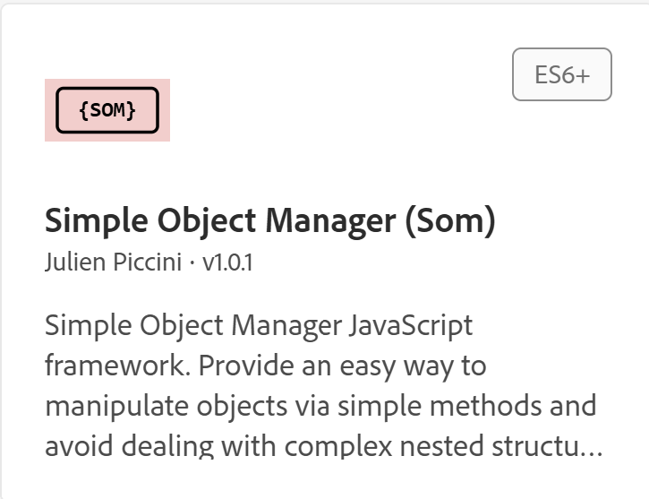
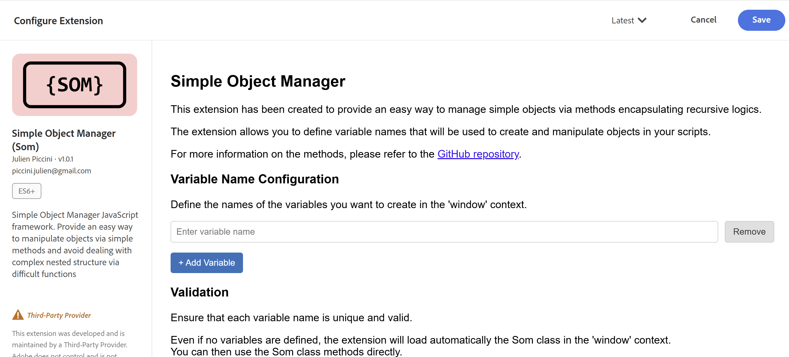

# SOM Extension

The SOM project is also available as an Adobe Launch Extension. This allows users to install the SOM extension directly into their Adobe Launch properties, providing a seamless integration experience.

## Table of Contents

- [SOM Extension](#som-extension)
  - [Table of Contents](#table-of-contents)
  - [Installation](#installation)
    - [Manual Implementation Guidelines](#manual-implementation-guidelines)
      - [Copying Project Setup](#copying-project-setup)
      - [Customizing the Extension Name](#customizing-the-extension-name)
      - [Generating and Uploading the Extension](#generating-and-uploading-the-extension)
        - [Release the extension](#release-the-extension)
  - [Configuration](#configuration)
  - [Usage](#usage)
    - [Example 1: Tracking your webpage information](#example-1-tracking-your-webpage-information)
    - [Example 2: Tracking a product view event](#example-2-tracking-a-product-view-event)
    - [Example 3: Tracking an Order Completed event](#example-3-tracking-an-order-completed-event)


## Installation

In order to install the Som extension into your Adobe Launch property, you have 2 options:

1. **Manual Installation**: You can manually generate the extension package via the different npx commands and upload it to your organization. The code is open source and this option is the best if you want to customize the extension to your needs or are afraid of relying on a third party service. 

2. **Request a shared extension**: You can request a shared extension from the author of this project. This is the easiest way to install the extension. What is needed is that you open a Github request and provide the IMS Org ID where you want the extension to be shared to. The author will take care of generating and sharing the extension with your organizations.\
You will need to accept this extension before using it.\
The installation is documented in the [official Adobe documentation](https://experienceleague.adobe.com/en/docs/experience-platform/tags/api/guides/extension-packages).

### Manual Implementation Guidelines

#### Copying Project Setup

Copy the project from Github by running one of these commands: 
```bash
git clone https://github.com/pitchmuc/Simple-Object-Manager.git
## or 
git clone git@github.com:pitchmuc/Simple-Object-Manager.git
```

#### Customizing the Extension Name

Once your project is copied, you can directly go to the /extension folder and open the file `extension/extension.json`.\
In this file, you can modify the 2 keys `name` and `displayName` to customize the name of your extension for your organization.\
While the display name does not need to be unique, **the name key must be unique across organizations**.\
As this extension has already been released and is being used by multiple organizations, it is recommended to change the name key to something unique to your organization.\
For example, you can add your company name as a prefix or suffix to the name.\

#### Generating and Uploading the Extension

After changing the name, you can generate the extension package by running the following command from the /extension folder: 
```bash
npx @adobe/reactor-packager
```
This will generate a file called `package-name.1.0.1.zip` in the /extension folder.\

you can then upload this file to your Adobe Launch organization by running the following command: 
```bash
npx @adobe/reactor-uploader
```

In order to do so, you would need to have created a Project in the Adobe Developer Console and have the credentials available. It request for your clientID and your secret.

Once that is done, the extension can be checked and install from the Adobe Launch interface, for Development enabled properties. 

##### Release the extension 

Once you are satisfy with your testing, you can then release the extension in your organization, by using the following command line: 
```bash
npx @adobe/reactor-releaser
```

## Configuration

To add your extension to your Adobe Launch property, you will need to configure it after installation. 
If you have not changed the icon during the manual installation, the extension should appear to something similar as: 


The configuration panel is straightforward: 


Nothing is really required, but you can provide name of variables that you want to extension to automatically create when Launch, and the extension are loaded on your page.\
These variables will be Som objects, which you can use in your rules and data elements.

## Usage

Once the extension is installed and configured, you can start using it in your Adobe Launch rules and data elements.\
You will find the Som methods available in this documentation: [SOM methods](./Simple_Object_Manager_Methods.md).

The main benefits of Som objects are:
- Easy to use methods to get and set values in complex objects
- Safe access to nested properties without worrying about undefined errors
- Ability to set default values when getting properties
- assign values to nested properties easily, creating the structure if it does not exist

here are some examples on how to use the extension in your rules for XDM tracking. 
In the example below, I will assume that you have created a Som object called `xdm` in the configuration panel of the extension.


### Example 1: Tracking your webpage information 

```javascript
// get your Google Data dataLayer as a Som object

myDataLayer = new Som(dataLayerHandler);
// using the som Object to build your xdm.web.webPageDetails object
// assuming the following structure in your dataLayer:
/***
{    
    page: {
        "name": "Home",
        "id": "4d240591-acad-4e01-a055-26e492529343",
        "type": "Home",
        "viewport": "XXL",
        "sitemap": "home",
        "language": "de",
        "country": "de",
        "nameSitemap": "home"
    },
    platform:{
      "brand": "my Brand",,,
      "name": "my Platform",
      "id": "s12d213",
      "medium": "web",
      "environment": "prod",
      "version": "2.50.1"
  }
}
*/
xdm.assign('eventType', 'page.pageView');
xdm.assign('web.webPageDetails.URL', window.location.href);
xdm.assign('web.webPageDetails.name', myDataLayer.get('page.name','unknown'));
xdm.assign('web.webPageDetails.server', window.location.hostname);
xdm.assign('web.webPageDetails.language', myDataLayer.get('page.language','unknown'));
xdm.assign('web.webReferrer.URL', document.referrer);
xdm.assign('web.webPageDetails.pageViews.value', 1);

alloy("sendEvent", {
    'xdm': xdm.get()
});
```

As you can see you can set the different elements of the XDM schema using the Som methods easily and it feels very similar to the old s. object way of doing things.

### Example 2: Tracking a product view event

```javascript
// get your Google Data dataLayer as a Som object
myDataLayer = new Som(dataLayerHandler);
// using the som Object to build your xdm commerce object
// assuming the following structure in your dataLayer:
/***
{    
    event: 'productView',
    ecommerce: {
        detail: {
            products: [
                {
                    name: "Triblend Android T-Shirt",
                    id: "12345",
                    price: "15.25",
                    brand: "Google",
                    category: "Apparel",
                    variant: "Gray"
                }
            ]
        }
    }
}
*/
if(myDataLayer.get('event') === 'productView'){
    var product = myDataLayer.get('ecommerce.detail.products.0');
    xdm.assign('eventType', 'commerce.productView');
    xdm.assign('commerce.productViews.value', 1);
    xdm.assign('productListItems.[0].SKU', product.id);
    xdm.assign('productListItems.[0].name', product.name);
    xdm.assign('productListItems.[0].price', product.price);
    xdm.assign('productListItems.[0].currencyCode', product.currencyCode, 'USD');
}
alloy("sendEvent", {
    'xdm': xdm.get()
});
```

### Example 3: Tracking an Order Completed event

```javascript
// get your Google Data dataLayer as a Som object
myDataLayer = new Som(dataLayerHandler);
// using the som Object to build your xdm commerce object
// assuming the following structure in your dataLayer:
/***    
{    
    event: 'purchase',
    ecommerce: {
        purchase: {
            actionField: {
                id: 'T12345',                         // Transaction ID. Required for purchases and refunds.
                affiliation: 'Online Store',
                revenue: '35.43',                     // Total transaction value (incl. tax and shipping)
                tax: '4.90',
                shipping: '5.99',
                coupon: 'SUMMER_SALE'
            },
            products: [                                // List of productFieldObjects.
                {
                    name: 'Triblend Android T-Shirt',   // Name or ID is required.
                    id: '12345',
                    price: '15.25',
                    brand: 'Google',
                    category: 'Apparel',
                    variant: 'Gray',
                    quantity: 1,
                    coupon: ''                           // Optional fields may be omitted or set to empty string.
                },
                {
                    name: 'Donut Friday Scented T-Shirt',
                    id: '67890',
                    price: '33.75',
                    brand: 'Google',
                    category: 'Apparel',
                    variant: 'Black',
                    quantity: 1
                }
            ]
        }
    }
}
*/
if(myDataLayer.get('event') === 'purchase'){
    var purchase = myDataLayer.get('ecommerce.purchase');
    xdm.assign('eventType', 'commerce.order');
    xdm.assign('commerce.order.purchaseID', myDataLayer.get('ecommerce.purchase.actionField.id'));
    xdm.assign('commerce.order.priceTotal', myDataLayer.get('ecommerce.purchase.actionField.revenue'));
    xdm.assign('commerce.order.taxAmount', myDataLayer.get('ecommerce.purchase.actionField.tax'));
    xdm.assign('commerce.shipping.shippingAmount', myDataLayer.get('ecommerce.purchase.actionField.shipping'));
    // loop through products
    var products = purchase.products;
    for(var i=0; i<products.length; i++){
        var product = products[i];
        xdm.assign('productListItems.['+i+'].SKU', myDataLayer.get('ecommerce.purchase.products.'+i+'.id'));
        xdm.assign('productListItems.['+i+'].name', myDataLayer.get('ecommerce.purchase.products.'+i+'.name'));
        xdm.assign('productListItems.['+i+'].priceTotal', myDataLayer.get('ecommerce.purchase.products.'+i+'.price')*myDataLayer.get('ecommerce.purchase.products.'+i+'.quantity'));
        xdm.assign('productListItems.['+i+'].quantity', myDataLayer.get('ecommerce.purchase.products.'+i+'.quantity'));
        xdm.assign('productListItems.['+i+'].currencyCode', myDataLayer.get('ecommerce.purchase.products.'+i+'.currencyCode'), 'USD');
    }
}
alloy("sendEvent", {
    'xdm': xdm.get()
});
```
